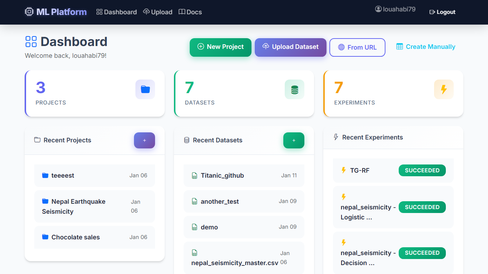

<div align="center">

# 🚀 Machine Learning Analytics Platform
### *An End-to-End Web Platform for Dataset Preprocessing, Multi-Algorithm Training & Model Evaluation*

[](https://www.python.org/)
[](https://www.djangoproject.com/)
[](https://scikit-learn.org/)
[](https://www.django-rest-framework.org/)
[](https://plotly.com/)
[](LICENSE)

<br/>



<br/><br/>

[Features](#-key-features) • [Architecture](#-system-architecture) • [Supported Algorithms](#-supported-algorithms) • [Tech Stack](#-technology-stack) • [Getting Started](#-getting-started) • [API Documentation](#-api-endpoints)

</div>

---

## 📌 Overview

**Machine Learning Analytics Platform** is a full-stack, modular web platform designed to streamline the entire Machine Learning lifecycle—from exploratory data analysis and feature engineering to multi-algorithm model training, cross-validation, and interactive evaluation. 

Designed for data practitioners, researchers, and students, the platform integrates robust backend pipelines (Scikit-learn & Django REST Framework) with interactive visualization (Plotly & Matplotlib) and built-in educational tutorials detailing mathematical intuition and practical use cases.

---

## ✨ Key Features

### 1. 📊 Dataset Ingestion & Preprocessing
- **Flexible Data Ingestion**: Upload datasets (CSV, Excel `.xlsx`) or import directly from any public URL.
- **Automated Exploratory Data Analysis (EDA)**: Instant statistical summaries, missing value detection, shape analysis, and distribution previews.
- **Configurable Preprocessing Pipelines**:
  - Missing value imputation (`mean`, `median`, `most_frequent`, `constant`, row/column drop).
  - Categorical feature encoding (`OneHotEncoder`, `OrdinalEncoder`).
  - Feature scaling (`StandardScaler`, `MinMaxScaler`, `RobustScaler`).
  - Polynomial feature interaction & Variance Threshold filtering.
- **Manual Feature Engineering**: Derive, transform, or curate custom feature subsets prior to training.

### 2. 🤖 Multi-Algorithm Model Training & Experimentation
- **Extensive Model Catalog**: Over 15 algorithms across Classification, Regression, and Clustering.
- **Dynamic Hyperparameter Tuning**: Model-specific schemas validated at runtime using JSON Schema.
- **Cross-Validation Framework**: Stratified K-Fold (classification) and K-Fold (regression) with mean and standard deviation scoring across folds.
- **Model Persistence**: Serialized pipeline artifacts (`.joblib`) saved for reproducibility and instant inference.

### 3. 📈 Interactive Analytics & Evaluation
- **Visual Diagnostics**:
  - Actual vs. Predicted scatter plots with regression trends and residual distributions.
  - Interactive Confusion Matrices with multi-class heatmaps.
  - Learning curves and cross-validation variance charts.
  - Interactive correlation heatmaps and distribution histograms powered by **Plotly**.
- **Comprehensive Evaluation Metrics**:
  - *Classification*: Accuracy, Precision, Recall, Macro F1-Score.
  - *Regression*: RMSE, MAE, R² Score.

### 4. 🔮 Real-Time Predictions & Model Comparison
- **Inference Engine**: Test trained models on new inputs directly via the web interface or through the REST API.
- **Side-by-Side Comparison**: Benchmark different algorithms and hyperparameter configurations on the same dataset split.

### 5. 📚 Built-in Interactive Educational Modules
- Educational cards and interactive guides covering mathematical intuition, loss functions, prerequisites, strengths, and limitations for each algorithm.

---

## 🧠 Supported Algorithms

| Algorithmic Family | Model Name | Task Type |
| :--- | :--- | :--- |
| **Linear Models** | Simple Linear Regression | Regression |
| | Multiple Linear Regression | Regression |
| | Logistic Regression (L1, L2, ElasticNet) | Classification |
| **Tree-Based Models** | Decision Tree Classifier | Classification |
| | Decision Tree Regressor | Regression |
| | Random Forest Classifier | Classification |
| | Random Forest Regressor | Regression |
| **Kernel & Distance** | Support Vector Machine (SVC) | Classification |
| | Support Vector Regression (SVR) | Regression |
| | k-Nearest Neighbors (k-NN Classifier) | Classification |
| | k-Nearest Neighbors (k-NN Regressor) | Regression |
| **Probabilistic** | Gaussian Naive Bayes | Classification |
| | Multinomial Naive Bayes | Classification |
| | Bernoulli Naive Bayes | Classification |
| **Clustering** | K-Means Clustering | Unsupervised |
| **Neural Networks** | Multi-Layer Perceptron (MLPClassifier) | Classification |
| | Multi-Layer Perceptron (MLPRegressor) | Regression |

---

## 🏗️ System Architecture

```
ml_platform/
├── apps/
│   ├── datasets/         # Dataset models, upload handlers, EDA & preprocessors
│   ├── ml_models/        # Pipeline builders, experiment runners, metrics & persistence
│   │   ├── services/     # Core domain logic (pipeline_builder, experiment_runner, etc.)
│   │   └── management/   # Seed commands & database initializers
│   ├── visualization/    # Interactive Plotly & Matplotlib chart generation
│   ├── api/              # RESTful API endpoints, viewsets & serializers (v1)
│   └── users/            # Authentication, accounts & workspace profiles
├── config/               # Django root settings, WSGI/ASGI & root routing
├── templates/            # Django responsive HTML5 templates & modular components
├── static/               # CSS styles, JavaScript interactive charts, asset bundles
├── media/                # Uploaded datasets and serialized model artifacts (.joblib)
├── manage.py
└── requirements.txt      # Project dependencies
```

---

## 🛠️ Technology Stack

- **Backend Framework**: Python 3.10+, Django 6.0, Django REST Framework (DRF)
- **Machine Learning**: Scikit-learn, Pandas, NumPy, SciPy
- **Data Visualization**: Plotly, Matplotlib, Seaborn
- **Database**: SQLite (Development) / PostgreSQL (Production ready)
- **Frontend**: HTML5, Modern CSS3, JavaScript (ES6+), Bootstrap

---

## 🚀 Getting Started

### Prerequisites
- Python 3.10+
- Git

### 1. Clone the Repository
```bash
git clone https://github.com/oussama-allouch/Machine-Learning-Analytics-Platform.git
cd Machine-Learning-Analytics-Platform
```

### 2. Set Up Virtual Environment
```bash
# Windows
python -m venv venv
venv\Scripts\activate

# macOS / Linux
python3 -m venv venv
source venv/bin/activate
```

### 3. Install Dependencies
```bash
pip install --upgrade pip
pip install -r requirements.txt
```

### 4. Apply Migrations & Seed Algorithms
```bash
python manage.py migrate
python manage.py seed_algorithms
```

### 5. Create an Administrator Account (Optional)
```bash
python manage.py createsuperuser
```

### 6. Run the Development Server
```bash
python manage.py runserver
```

Navigate to `http://127.0.0.1:8000/` in your browser.

---

## 🔌 API Endpoints (v1)

| Method | Endpoint | Description |
| :--- | :--- | :--- |
| `GET / POST` | `/api/v1/datasets/` | List or upload datasets |
| `GET` | `/api/v1/datasets/{id}/preview/` | Preview dataset rows and schema |
| `GET / POST` | `/api/v1/pipelines/` | List or configure preprocessing pipelines |
| `GET / POST` | `/api/v1/experiments/` | List or launch ML model training experiments |
| `GET` | `/api/v1/experiments/{id}/report/` | Retrieve training report, metrics & charts |
| `POST` | `/api/v1/experiments/{id}/predict/`| Execute predictions with a trained model |
| `GET` | `/api/v1/algorithms/` | List available ML algorithms and hyperparameter schemas |

---

## 📄 License

This project is licensed under the MIT License - see the [LICENSE](LICENSE) file for details.

---

<div align="center">
Developed with ❤️ by <b>Oussama Allouch</b>
</div>
